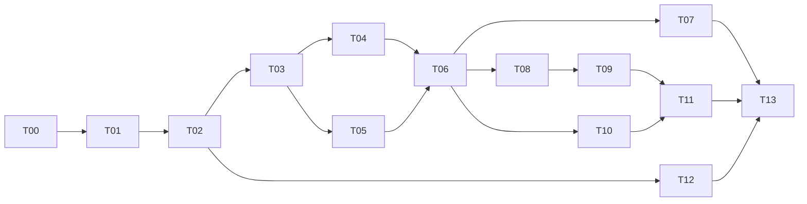

# Kế hoạch phát triển — Samsung SDS Skills Manager

Version 0.2 · 2026-10-16 · Draft for review, chưa bắt đầu implementation

Revision 0.2: đồng bộ W02 từ Stitch; xem [nguồn và phân biệt quyết định/đề xuất](W02-CHANGELOG.md).
## 1. Cách chia công việc

Kế hoạch theo các phần việc hoàn chỉnh từ góc nhìn nhân viên, áp dụng cách chia vertical slices của Matt Pocock. Đây là kế hoạch cục bộ để review, chưa publish ticket hoặc gắn trạng thái ready-for-agent. Không đưa ra thời hạn theo ngày khi chưa biết nhân lực, lịch Store và hạ tầng IT.

Phase 1 hiện tại kết thúc ở bộ tài liệu và wireframe. Các mốc D0–D6 dưới đây thuộc giai đoạn phát triển sau. Không có coding/test task nào đã thực hiện trong Phase 1; tiêu chí bàn giao là yêu cầu kết quả, không phải báo cáo test.

## 2. Mốc và phụ thuộc

| Mốc | Đầu ra | Công việc | Điều kiện |
|---|---|---|---|
| D0 — Chốt thiết kế | Phạm vi, API và deployment profile đã thống nhất | T00 | Review P/V cùng Product, Store, IT |
| D1 — Truy cập nội bộ | Đăng nhập, tìm và xem skill theo quyền | T01–T02 | Auth/catalog facade và network profile |
| D2 — Cài được AIPro | Cài một skill global, MCP warning, progress và result | T03–T04 | Release/package contract |
| D3 — Đủ agent/phạm vi | Bốn agent, project/global, presets | T05–T07 | Đường dẫn/phiên bản agent được xác minh |
| D4 — Quản lý vòng đời | Update chọn lọc, backup/restore, gỡ có phạm vi | T08–T10 | Release metadata và deployment state |
| D5 — Hoạt động khi mất Store | Library offline, phiên đăng nhập và recovery rõ ràng | T11 | Chốt P07/V03 |
| D6 — Phân phối nội bộ | Bộ cài, thông báo bản app mới, hướng dẫn hỗ trợ | T12–T13 | IT runtime, signing, phân phối |

Đây là dependency graph công việc, không phải chỉ thị mở agent song song. Nhóm Store có thể chuẩn bị API độc lập sau D0; app dùng schema draft nội bộ để phát triển nhưng tích hợp thật cần endpoint thật.

## 3. Các phần việc đề xuất

### T00 — Thống nhất phạm vi và hợp đồng với Store/IT

**Blocked by:** Không. **Owner:** Product + Store + IT + Desktop.

**Đầu ra:** bộ spec được review, định danh app/Store và release contract dùng chung. Chốt P01 phạm vi Local Install được mở lại, P09 hành vi query và V07 ranking/Source taxonomy, P03 backup scope, P04 cập nhật app, P06 agent flavors, P07 offline/account; V01 paths và V02 runtime.

**Hoàn thành khi:** mỗi giả định đã có quyết định hoặc owner và mốc cung cấp; có API fixtures không chứa dữ liệu công ty thật; release ID/sequence/package digest không nhập nhằng với metadata version. Không cản review wireframe vì chưa có URL thật.

### T01 — Mở app nội bộ và đăng nhập tài khoản Store

**Blocked by:** T00. **Owner:** Desktop + Store. **SRS:** AUTH-01/02, SET-01. **Screens:** W01,W12,W14.

**Đầu ra:** profile SDS dùng English, giữ app shell, đăng nhập/refresh/logout; lỗi phiên và mạng được phân biệt. Git/public marketplace/updater/CLI bị vô hiệu hóa ở runtime và UI, giữ source upstream.

**Hoàn thành khi:** nhân viên dùng tài khoản Store vào app, token không xuất hiện trong log/SQLite; không có tác vụ nền công khai hoặc CLI setup còn tự chạy. Nhận diện nguồn data cũ mà không tự xóa chúng.

### T02 — Tìm và đọc skill từ Store theo quyền

**Blocked by:** T01. **Owner:** Desktop + Store. **SRS:** CAT-01/02/03/04/05. **Screens:** W02,W03.

**Đầu ra:** Install Skills với Store/Local Install; Store có All Time/Trending/Hot, keyword, Source chips/overflow và pagination theo W02 mới. Bỏ dropdown role/agent/sort cũ. Detail có release, format, compatible agents, MCP, guide. Local Install chỉ triển khai nội dung sau khi P01 chốt; khi mở import phải bổ sung phạm vi T03–T06 cho validation, origin, MCP và update metadata. Có loading/empty/error states và link chia sẻ trên Store web.

**Hoàn thành khi:** query/mode/Source gửi đúng API, đổi điều kiện reset page, giữ state khi quay về, response cũ không ghi đè; ranking do server trước pagination và mode unavailable có trạng thái rõ; rights do server kiểm soát; thiếu requiredMcps khác []; không auto-load public content từ Markdown.

### T03 — Cài một release ZIP/7z vào AIPro global

**Blocked by:** T02 và API immutable package. **Owner:** Desktop + Store. **SRS:** INS-01/03/04/05, LIB-01. **Screens:** W04,W06,W07.

**Đầu ra:** một luồng end-to-end từ Store đến Library và global AIPro, checksum, staging, copy, baseline metadata, progress/cancel/journal. Thêm 7z vào package preparation trong cùng luồng, không dựng installer độc lập.

**Hoàn thành khi:** đúng một root SKILL.md được cài giữ tài nguyên, archive bất hợp lệ không thay target, install result có path/release và khôi phục được khi commit gián đoạn.

### T04 — Cảnh báo MCP AIPro trước cài và cập nhật

**Blocked by:** T03. **Owner:** Desktop + Store. **SRS:** MCP-01…05. **Screen:** W05.

**Đầu ra:** đọc requiredMcps/mcpServers, Configuration found/Missing/Cannot verify/Unknown; guide, retry, install anyway, cancel. Áp dụng ở coordinator để mọi entry point đều dùng chung.

**Hoàn thành khi:** file global dùng cho cả scope; không lộ token; skip chỉ cho operation hiện tại; kết quả cài có warning còn thiếu, không khẳng định MCP chạy được.

### T05 — Cài global cho Claude, Gemini và Codex

**Blocked by:** T03 và V01. **Owner:** Desktop + agent owners. **SRS:** INS-01/02/07, MCP-05. **Screens:** W04,W06,W12.

**Đầu ra:** bốn agent xuất hiện, path/detection/override rõ, chọn nhiều target và kết quả riêng. Không tự dựng thêm agent adapters không cần thiết.

**Hoàn thành khi:** paths đúng bản agent SDS; không nhận trùng Codex ở hai root; ba agent này không hiển thị MCP passed giả; lỗi một target không làm mất thành công target khác.

### T06 — Global/project workspace và cài chọn lọc

**Blocked by:** T04,T05. **Owner:** Desktop. **SRS:** INS-01/02/06/07, LIB-01. **Screens:** W04,W07,W08.

**Đầu ra:** thêm project, xem skills của agent theo project/global, Add from Library, chọn đích rõ ràng và phát hiện trùng/khác skill ID.

**Hoàn thành khi:** deployment độc lập từng target, không ghi vào rules/agents/config, trạng thái Library và workspace phản ánh file thực tế, badge action cũng qua review khi cần.

### T07 — Preset và thao tác nhiều skill

**Blocked by:** T06. **Owner:** Desktop. **SRS:** PRE-01. **Screen:** W08.

**Đầu ra:** tạo/sửa preset từ Library, chọn skill/agent/scope, resolve release và báo kết quả theo từng cặp. Giữ tags/grid/list và thao tác chọn nhiều từ app nền.

**Hoàn thành khi:** apply một lần, không live sync; missing permission/cache/MCP hiển thị trước cài; thay preset không tự thay project.

### T08 — Thông báo update và chọn target

**Blocked by:** T06 và updates API. **Owner:** Desktop + Store. **SRS:** UPD-01/02/04. **Screens:** W07,W09.

**Đầu ra:** check metadata, biểu thị version mỗi target, xem changelog và chọn cập nhật; requiredMcps lấy release mới.

**Hoàn thành khi:** không tự tải/cài; sửa description không tạo update giả; target không chọn giữ bản cũ; release bị rút hoặc mất quyền giữ deployment hiện tại. Target có local edits tạm giữ nguyên và báo cần xử lý conflict; chỉ cho thay thế sau khi T09 cung cấp snapshot/review đầy đủ.

### T09 — Giữ local edits, snapshot và khôi phục

**Blocked by:** T08. **Owner:** Desktop. **SRS:** UPD-03, BAK-01. **Screens:** W09,W11.

**Đầu ra:** nhận diện file thêm/sửa/xóa, Keep current hoặc Back up and update, danh sách snapshot và restore theo target.

**Hoàn thành khi:** snapshot fail ngăn ghi đè; restore bảo vệ thay đổi mới; không đóng gói token/config; cùng skill ở project khác không thay đổi.

### T10 — Gỡ target và quản lý cache Library

**Blocked by:** T06. **Owner:** Desktop. **SRS:** REM-01/02. **Screen:** W13.

**Đầu ra:** remove có scope/path, cảnh báo local edits, dọn cache release không dùng qua hành động riêng.

**Hoàn thành khi:** không gỡ global khi chọn project; không xóa skill root hoặc tài nguyên ngoài skill; release còn referenced không bị xóa khỏi Library. Snapshot service có thể dùng primitive từ T03, UI restore đầy đủ ở T09.

### T11 — Offline, session expiry và khôi phục thao tác gián đoạn

**Blocked by:** T09,T10 và quyết định P07/V03. **Owner:** Desktop + IT.

**SRS:** OFF-01, AUTH-02, INS-07. **Screen:** W10.

**Đầu ra:** local actions khi Store unreachable; phân biệt cached catalog với data hiện hành; khôi phục journal khi restart và retry target lỗi.

**Hoàn thành khi:** không tải skill chưa cache offline; 401/403 không bị lẫn lỗi mạng; đổi account không trộn catalog; quyền đã thu hồi online không bị mô tả sai là quyền hiện tại.

### T12 — Bộ cài và thông báo app update nội bộ

**Blocked by:** T02, V02 và internal app feed. **Owner:** Desktop + IT.

**Đầu ra:** định danh app riêng, bộ cài offline phù hợp runtime công ty, thông báo version và link tải nội bộ. Có thể chuẩn bị packaging trước khi tất cả luồng hoàn tất; phát hành thực tế sau T13.

**Hoàn thành khi:** không bootstrap WebView2 từ Internet khi cài trong mạng chặn; phù hợp admin policy; installer và skill version không trộn; upstream updater bị tắt.

### T13 — Hoàn thiện trải nghiệm và bàn giao nội bộ

**Blocked by:** T07,T11,T12. **Owner:** Desktop + Product + IT.

**SRS:** SET-01, LOG-01 và tiêu chí toàn bộ scope. **Screens:** W12,W14.

**Đầu ra:** onboarding, lỗi/hướng dẫn English thống nhất, activity/export log đã lọc secret, hướng dẫn support, danh sách hạn chế và quyết định còn hoãn. Bàn giao gói sản phẩm theo quy trình phát hành công ty; điều kiện kiểm định khi triển khai sẽ được thống nhất ở giai đoạn đó, không thực hiện trong Phase 1.

## 4. Ưu tiên và giới hạn

Đường đi trọng tâm: auth/catalog → package cài AIPro → MCP → nhiều agent/project → update bảo vệ local edits → phân phối nội bộ. Không bắt đầu bằng dashboard số liệu, redesign UI, engine Git mới hoặc hệ thống quản trị riêng trong desktop.

Khoanh vùng refactor vào Store gateway và coordinator chung; tái sử dụng component/path guards/DB. Không thay toàn bộ UI hoặc routing chỉ để tích hợp Store. Giữ source chức năng bị tắt, nhưng không để callable background path còn hoạt động ngoài profile.

## 5. Rủi ro / điều kiện quyết định

| Rủi ro | Cách xử lý trong kế hoạch |
|---|---|
| Store API chưa chốt | Draft schema + immutable release trước T03; không bind release vào version cũ |
| “Tất cả từ Store” mâu thuẫn đề xuất giữ import | Chốt P01 ở T00: W02 mới có Local Install nhưng chưa có nội dung/phạm vi import |
| Copy thay symlink làm khác hành vi nền | Chốt P02; giữ target version độc lập để đúng update chọn lọc |
| Agent bản công ty khác path hiện tại | V01 trước T05, path override được lưu rõ |
| Snapshot bị hiểu là backup cả máy | P03 giới hạn local snapshots; UI nói rõ phạm vi |
| Network bị chặn khi install/update | V02 và T12 bao gồm runtime provisioning, CA và public callbacks |
| Quyền Store thay đổi khi offline | Chốt chính sách P07/V03, không hứa thu hồi file đã cài |

Sau review, có thể tách T00–T13 thành các ticket trên tracker nội bộ. Chưa đăng ticket, commit, tạo PR hoặc liên hệ đội dự án trong Phase 1 này.
