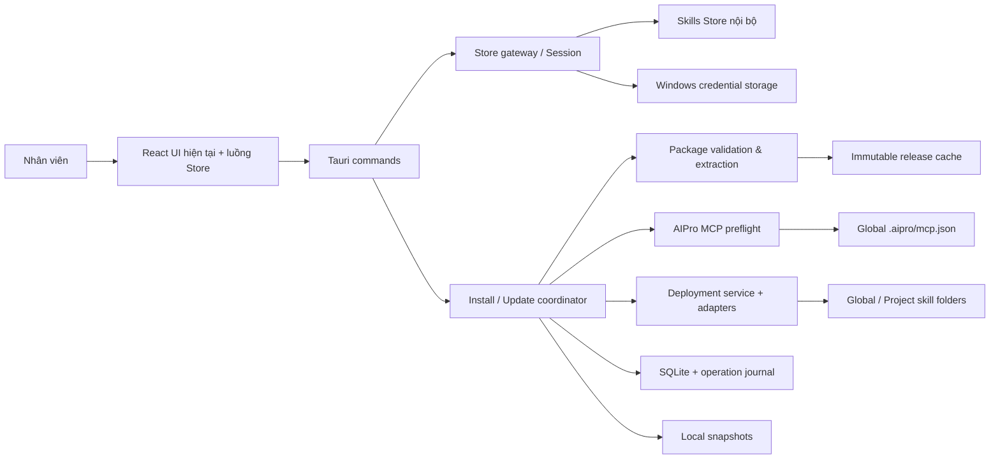
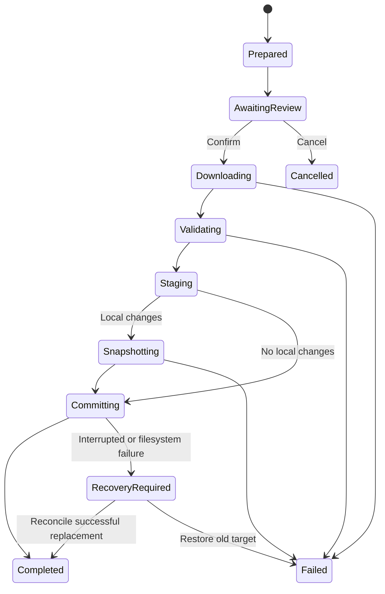

# SAS — Software Architecture Specification

Version 0.2 · 2026-10-16 · Draft for review

Revision 0.2: đồng bộ W02 từ Stitch; xem [nguồn và phân biệt quyết định/đề xuất](W02-CHANGELOG.md).
## 1. Kiến trúc được đề xuất

Giữ React/TypeScript + Tauri/Rust, tái sử dụng Library, workspace, preset, adapter, file guards và SQLite. Bổ sung lớp Store nội bộ, quản lý release/package và kiểm tra MCP AIPro. Không chuyển app thành web wrapper: các thao tác filesystem vẫn thuộc Rust backend.

Đã cân nhắc ba hướng: (1) chỉ đổi URL marketplace và tái sử dụng metadata Git — thay đổi ít nhưng không đủ auth/release/MCP; (2) **giữ UI, thêm Store boundary và mở rộng installer/deployment — được đề xuất**; (3) viết desktop mới bao quanh Store web — tái sử dụng web nhưng mất lợi thế quản lý local đã có và trái mục tiêu giữ giao diện. Phương án 2 tách dữ liệu Store khỏi logic triển khai mà vẫn dùng nền tảng hiện tại.

Không có luồng Git/public marketplace trong profile bản đầu. GitHub nội bộ tương lai có thể nằm phía sau Store; desktop tiếp tục tiêu thụ cùng hợp đồng release/package.

## 2. Trách nhiệm và giao diện module

| Module | Trách nhiệm | Giao diện khái niệm | Phụ thuộc |
|---|---|---|---|
| UI | Hiển thị catalog/local state, thu lựa chọn, thông báo tiến độ | Query catalog/detail, prepare/confirm/cancel operation | Tauri commands, không trực tiếp đọc token/file |
| Session service | Login, refresh tuần tự, logout, phân biệt offline/expired | login, sessionStatus, authenticatedRequest | Store gateway, credential storage |
| Store gateway | Ánh xạ API draft, catalog, release, tải package | search, detail, release, updates, download | Network profile nội bộ |
| Package service | Hash byte archive, giới hạn, giải nén, tìm root | prepareRelease → validated local artifact | ZIP/7z reader, temp storage, path guards |
| Operation coordinator | Chuẩn bị, xác nhận cảnh báo, lock, journal, kết quả từng target | prepare → review plan → execute/cancel | Package, MCP, deployment, DB |
| Agent adapters | Đường dẫn, nhận diện, project path, label | resolveTarget, detectAvailability | Bốn adapter, settings override |
| MCP preflight | Đọc global file AIPro và đối chiếu requiredMcps | inspect → per-name state + reason + checkedAt | Local read only |
| Deployment service | Copy/stage/replace/gỡ an toàn trong đúng target | deploy, remove, fingerprint, restore | Existing sync engine/path guards/locks |
| Library repository | Skill/release/deployment/preset/log/journal | List/query and transactional metadata updates | SQLite, filesystem |
| Snapshot service | Lưu bản local trước thay đổi và phục hồi | snapshotTarget, list, restore | Local storage + manifests |

Tauri command boundary là đầu vào thống nhất cho luồng; không để mỗi màn hình tự có installer riêng. Thao tác từ Store, Library, badge, preset và bulk đều đi qua coordinator nên không bỏ qua MCP/conflict review.

### Catalog state cho W02 revision 0.2

UI giữ `activeTab` (Store/Local Install) riêng với `CatalogQuery {q, mode, sourceId, page, pageSize}`. Store mặc định All Time/All sources. Query gửi qua gateway tới Store nội bộ; Source không chọn URL/provider public. Ranking/filter/ACL chạy trên server trước pagination; client không sort chỉ một trang. Role/agent metadata giữ nguyên nhưng không có dropdown lọc trên W02 mới.

Query cache key gồm profileId, userId và toàn bộ query chuẩn hóa; cache response giữ ordered skill IDs, totalItems, fetchedAt. CatalogCache bên dưới lưu metadata từng skill, không đủ để thay cache của từng mode. Taxonomy sources/catalogModes cache riêng theo account/profile. Bỏ response đến muộn khi query thay đổi; reset page khi đổi điều kiện, giữ state khi quay từ detail. Offline không tính lại Trending/Hot từ Library; chỉ hiện cache có timestamp hoặc state unavailable.

Semantics ranking và Source cần V07; UI interaction P09. Local Install có tab nhưng chờ P01 trước thiết kế input và origin/release/MCP metadata. Không tự đưa local package vào Store release hoặc thêm đường network mới. Xem [W02 change](W02-CHANGELOG.md).

## 3. Model dữ liệu cục bộ đề xuất

| Entity | Trường chính và invariant |
|---|---|
| StoreProfile | profileId, baseUrl, permittedHosts, trust/proxy references; không chứa credential raw. |
| AccountSessionRef | storeProfileId, userId, lastLoginAt, credentialRef; token không ghi SQLite. |
| CatalogCache | profileId + userId + skillId, metadata, fetchedAt; không dùng lẫn tài khoản. |
| Skill | storeProfileId + skillId, displayName, installName, source; tên không phải primary key. |
| Release | skillId + releaseId, sequence, label, archiveSha256, contentManifest, requiredMcps, compatibleAgents, localState. Bất biến sau xác minh. |
| Deployment | skillId, releaseId, agentKey, workspaceId, canonicalTargetPath, baselineManifest/hash, mcpCheck, installedAt; unique theo skill/agent/workspace. |
| Workspace | id, type global/project/linked, path; linked workspace giữ khả năng quản lý local theo app nền. |
| Preset | id, name, ordered skill references; khi áp dụng resolve release rõ ràng và lưu vào operation. |
| Snapshot | id, deploymentId, originalPath, manifest, savedAt, reason, content location; không chứa cấu hình AIPro/account. |
| Operation | operationId, frozen plan, status, per-target stage/backup/commit state, error, timestamp. |

App cần phân biệt Store skill ID và ID hiện tại trong DB nền; ưu tiên bổ sung metadata/tables bằng migration, không thay key cũ hàng loạt. Skill legacy/local giữ origin rõ ràng; không tự gắn Store ID chỉ vì trùng tên.

## 4. Agent và đường dẫn

| Agent | Global | Project | Căn cứ |
|---|---|---|---|
| AIPro | `%USERPROFILE%\.aipro\skills` | `<project>\.aipro\skills` | C04, người dùng xác nhận |
| Claude Code | `%USERPROFILE%\.claude\skills` | `<project>\.claude\skills` | Adapter repo hiện tại, V01 |
| Gemini CLI | `%USERPROFILE%\.gemini\skills` | `<project>\.gemini\skills` | Adapter repo hiện tại, V01 |
| Codex | `%USERPROFILE%\.codex\skills` | `<project>\.codex\skills` | Adapter repo hiện tại, V01; repo cũng scan `.agents/skills` |

Các đường dẫn ba agent cuối là mô tả code đã đọc, không phải xác nhận hỗ trợ của mọi phiên bản sản phẩm. Giữ override path và không sao chép một skill vào cả hai root Codex mặc định vì có thể bị nhận trùng. Đầu mối agent cần chốt location cho phiên bản SDS trước khi phát hành. Chọn thư mục root project, app tính relative path; không bắt nhân viên tự ghép đường dẫn.

Skill cài vào `skills`; không sửa `rules`, `agents`, `config.json` hoặc `mcp.json`. Khi global và project có cùng skill, app hiển thị cả hai; chưa tuyên bố agent ưu tiên bản nào trước V01.

## 5. MCP preflight

Nguồn: requiredMcps của release + `%USERPROFILE%\.aipro\mcp.json`. Match theo exact standardized key; không gửi token, URL hoặc nội dung file lên Store. Không cần gọi endpoint MCP hoặc khởi động stdio/Python để kiểm tra sự hiện diện.

| Input | Kết quả |
|---|---|
| Không có AIPro trong target | not_applicable; các agent khác không có MCP check |
| requiredMcps = [] | not_required |
| requiredMcps = null/absent | requirements_unknown; cảnh báo cho AIPro |
| Không có file | config_missing |
| Không đọc được/JSON sai/mcpServers không phải object | unverifiable, kèm reason không chứa secret |
| Key thiếu hoặc value không phải object/nonempty | missing/invalid_configuration |
| Tất cả key có object không rỗng | configured; không khẳng định operational |

Mỗi kết quả có checkedAt. `Install anyway` ghi acknowledgment theo operation/target; không coi là exemption vĩnh viễn. `Check again` đọc lại file. Release mới chạy lại preflight. Dùng file global cho cả cài project theo C06; project MCP precedence vẫn thuộc V05.

## 6. Download và triển khai

1. Resolve release ID bất biến và quyền tải từ Store; freeze plan gồm skill/release/target/expected current hashes.
2. Hiển thị paths, trùng tên, local edits và MCP warnings. Người dùng xác nhận trước thay thế.
3. Tải archive vào staging; không chuyển credential qua redirect khác host. So checksum toàn file với release metadata trước giải nén.
4. Giải nén với giới hạn total bytes, entry count, depth. Từ chối path traversal, path tuyệt đối/UNC/drive, symlink/junction entries, tên Windows không hợp lệ. Hạn mức cụ thể theo profile, không coi 10MB upload hiện tại là total extracted limit.
5. Xác định đúng một skill root; giữ tài nguyên. Không mở archive con, không chạy scripts. Mã hóa/password-protected hoặc split 7z ngoài phạm vi bản đầu; trả hướng dẫn upload gói chuẩn.
6. Lưu release đã xác minh vào cache bất biến; acquisition không đồng nghĩa đã cài vào agent.
7. Lock target, so lại fingerprint trước commit để tránh file thay đổi sau màn review. Nếu khác thì yêu cầu review lại target.
8. Stage bản copy trên cùng volume với target. Nếu cần snapshot bản local, hoàn thành và kiểm tra manifest snapshot trước khi thay thế. Giữ bản rollback tạm trong journal.
9. Replace directory với cơ chế recovery trên Windows; cập nhật DB sau filesystem success. Không hứa atomic transaction xuyên filesystem/SQLite. Journal giúp đối soát nếu app tắt giữa bước.
10. Dọn staging chỉ khi commit đã ghi nhận. Không tự dọn bản rollback đang cần recovery.

Cache hit bỏ download nhưng vẫn validate manifest và target. Một operation nhiều target có kết quả riêng: không rollback target thành công chỉ vì target khác không đủ quyền. Retry chỉ áp dụng target thất bại. Cancel trong giai đoạn commit hoàn tất/rollback target đang xử lý trước khi dừng target tiếp theo.

## 7. Update, remove, snapshot

Release cache bất biến + copy deployment giải quyết yêu cầu cập nhật chọn lọc. Metadata update từ Store chỉ tạo thông báo; không chỉnh deployment. Fingerprint dùng danh sách relative paths và hash nội dung ổn định, nhận ra cả thêm/xóa file. Archive checksum và content fingerprint là hai khái niệm riêng.

Gỡ có xác nhận path/agent/scope. Local edits có lựa chọn snapshot. Xóa Library chỉ cho release không còn deployment dùng; cache và snapshot retention không được xóa phiên bản đang tham chiếu. Snapshot restore được xem như một deployment operation, kiểm tra conflict hiện tại và không đụng target khác. Snapshot giữ nguyên các chỉnh sửa, không gọi chúng là một Store release mới.

## 8. Auth, offline và network

Password gửi HTTPS tới Store và loại khỏi memory UI sau login. Access token giữ trong backend memory; refresh token qua Windows credential storage. Client refresh single-flight; mỗi request chỉ tự refresh/retry một lần để tránh vòng lặp. Không chọn TTL thay đội Store; server trả expiresIn. Logout cố revoke online, luôn xóa local credential ngay cả khi revoke không thành công.

Catalog cache phân theo account; downloaded files thuộc Windows profile. Chuyển account xóa/tách catalog nhưng không tự xóa deployment. Cache skill đã tải không cung cấp cơ chế thu hồi quyền tức thời; P07/V03 cần review chính sách. Auth expired không được coi là Store offline để tiếp tục gọi API với token lỗi.

StoreProfile chứa base URL, internal permitted hosts và proxy/trust. Dùng CA công ty, không tắt certificate verification. Markdown preview chặn auto-load ảnh public; gói UI/icon/font local. Internal setup guide có thể mở browser theo hành động người dùng.

Phải rà soát và vô hiệu hóa: skills.sh fetch, GitHub device flow, Git fetch/push, background auto-backup network, upstream skill auto-update, app updater public, CLI publishing/setup và các đường dẫn gọi từ command palette/settings. Comment/disable tại capability và scheduling, không chỉ ẩn button. Local hashing/snapshot không phụ thuộc Git remote.

## 9. Phân phối và vận hành

Đề xuất app identity riêng để không trộn settings/cache với upstream. Giữ dữ liệu upstream, import/migrate có snapshot nếu người dùng chọn chuyển; không ghi đè thư viện hiện hữu khi first run. Bộ cài nội bộ ưu tiên per-user nếu IT cho phép. Chốt Windows architecture, quyền, CA và offline WebView2 provisioning với IT trước phát hành.

App update: endpoint Store/internal release feed trả version + installer link + checksum/signing info. Bản đầu người dùng mở link nội bộ và cài; không tự restart. App và skill có version stream tách biệt. Logs ghi operationId/requestId và mã lỗi; không ghi body auth/MCP. Chưa đề xuất telemetry gửi server cho đến khi có nhu cầu và phạm vi rõ.

## 10. Các điểm cần review

P01–P08/V01–V06 tại README là nguồn duy nhất theo dõi giả định. Đặc biệt: copy vs symlink, local snapshot vs full backup, access khi offline, đường dẫn ba agent, release bất biến ở Store và disable các background network paths. Không có triển khai hoặc kết quả testing được tuyên bố trong SAS này.
